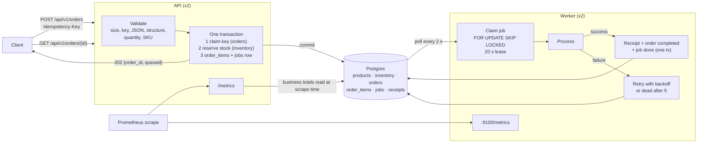
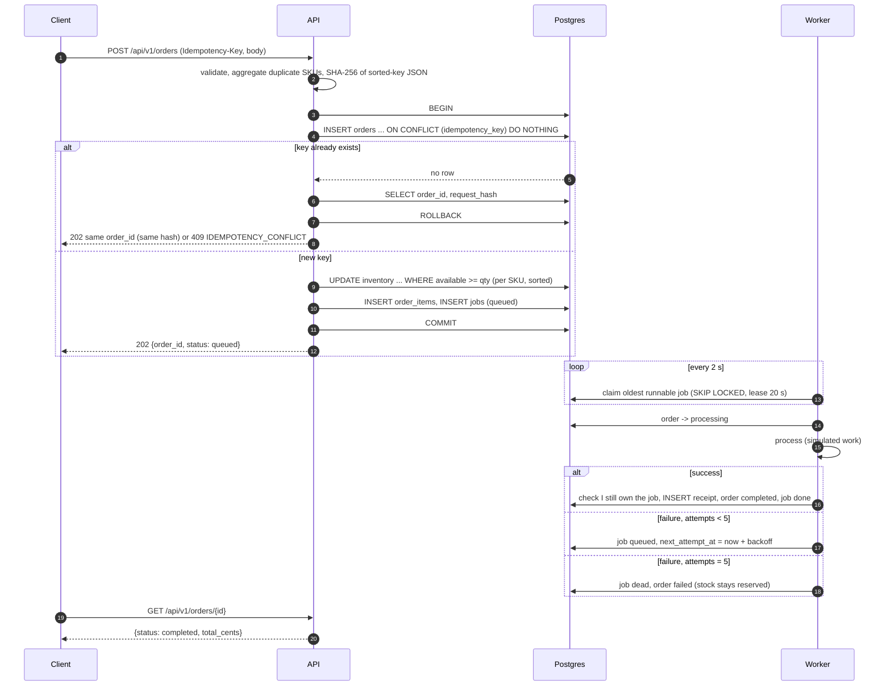
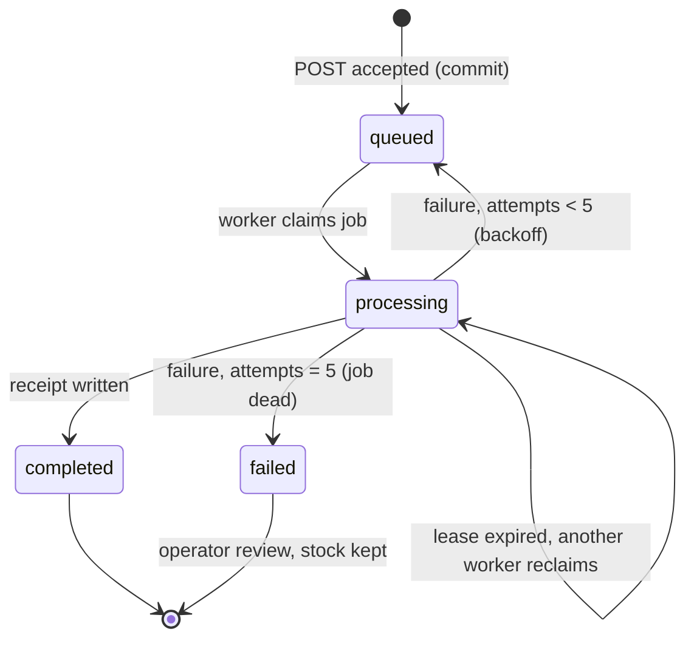
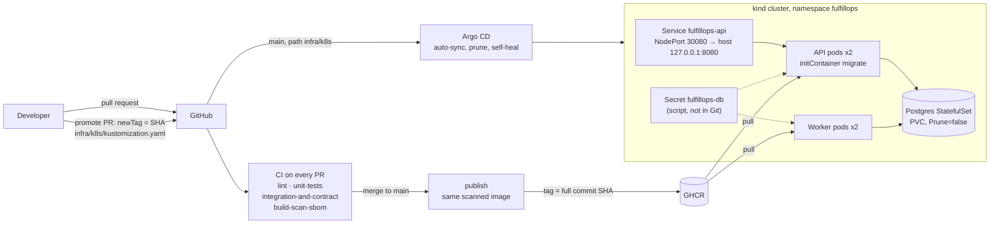

# Architecture

FulfillOps accepts orders over HTTP, commits them to Postgres in one transaction, and completes
them asynchronously in background workers. The same container image runs every role. This page
shows how a request travels from the client to a receipt and into the metrics, then where each
piece runs. The reasons behind the design are in [ADR-001](ADR-001.md).

## Components

| Component | Runs as | Responsibility | Code |
| --- | --- | --- | --- |
| API | 2 replicas (`api`, `api2` in Compose; Deployment `fulfillops-api` in Kubernetes) | Validates requests, reserves stock and records the order and its job in one transaction, serves reads, health and `/metrics` | `api/` |
| Worker | 2 replicas (`worker`; Deployment `fulfillops-worker`) | Claims jobs with a lease, completes orders, retries with backoff, dead-letters | `worker/` |
| Migrate | Compose one-shot service; Kubernetes initContainer of the API | Applies `db/migrations/*.sql` once each under an advisory lock | `common/migrate.py` |
| Postgres 16 | `db`; StatefulSet `fulfillops-postgres` + 1 Gi PVC | Single source of truth: catalog, stock, orders, jobs, receipts | `db/migrations/` |
| Redis 7 | `redis`; Deployment `fulfillops-redis` | Deployed but unused: `QUEUE_BACKEND=postgres` (wake-up signal deferred, see ADR-001) | — |

## Data flow: from request to receipt and metrics

### Order lifecycle

### Order states

## Where the guarantees live

| Guarantee | Mechanism | Evidence |
| --- | --- | --- |
| No overselling, never negative | `UPDATE ... WHERE available >= qty` + `CHECK (available >= 0)` | E06 |
| One order per key across replicas | `UNIQUE (idempotency_key)` + request hash | E05, E08 |
| Committed order never lost | Order, stock, lines and job in one transaction; 202 after commit | E04, E09 |
| Completed exactly once | Lease + ownership re-check + `receipts` primary key | E09 |
| Bounded retries | `attempts` vs `WORKER_MAX_ATTEMPTS = 5`, then `dead` | E10 |
| Only Ready pods get traffic | `/health/ready` checks the DB and the newest migration | E03, E19, E20 |

## Observability

- **API `/metrics`** (Prometheus text format): `fulfillops_http_requests_total{method,route,status}`
  and the latency histogram `fulfillops_http_request_duration_seconds{method,route}`, counted per
  process; business totals `fulfillops_orders_created_total`, `fulfillops_orders_completed_total`,
  `fulfillops_orders_failed_total`, `fulfillops_worker_retries_total`, read from Postgres at scrape
  time so every replica reports the same value. Labels use the route template, never real IDs.
- **Worker `:9100/metrics`**: `fulfillops_jobs_completed/retried/dead/reclaimed_total{worker}`.
- **Logs**: one JSON object per line on stdout with `ts`, `level`, `service`, `event` and IDs
  (`order_id`, `job_id`, `attempt`, `worker_id`). Never passwords, raw idempotency keys (only an
  8-character hash, `key_fp`), request bodies or exception messages.
- **SLO**: [slo.md](slo.md). Measured p95 24.3 ms over 300 requests on Compose (E21).

## Deployment

### Local: Docker Compose

`db` (healthy) → `migrate` (exits 0) → `api` on :8080, `api2` on :8081, `worker` ×2. Every app
container is read-only with `/tmp` as tmpfs, drops all capabilities and sets `no-new-privileges`.
`compose.fault.yaml` is a drill-only override (8 s processing, poison mode).

### Kubernetes: CI, registry, Git and Argo CD

- **Rollouts**: `RollingUpdate` with `maxSurge: 1`, `maxUnavailable: 0`, `minReadySeconds: 5`,
  `progressDeadlineSeconds: 90`. A new pod receives traffic only once `/health/ready` passes, and an
  old pod is removed only after a new one is available (E19: 961 probes, 0 failures).
- **Recovery**: a bad release is reverted in Git; Argo CD syncs the previous manifest (E20). Manual
  `kubectl` changes are reverted by self-heal (E18).
- **Pod hardening**: non-root UID 10001, read-only root filesystem, all capabilities dropped,
  `allowPrivilegeEscalation: false`, seccomp `RuntimeDefault`, no service-account token mounted,
  CPU and memory requests and limits on every container.
- **Secrets**: `scripts/create-secret.sh` builds Secret `fulfillops-db` from the untracked
  `.env.k8s`; it is never in Git and Argo CD does not manage it.
- **Supply chain**: actions pinned to commit SHAs, Trivy blocks CRITICAL/HIGH with a fix, Syft
  SBOM on every build, immutable SHA tags. Details in [supply-chain.md](supply-chain.md); threats in
  [threat-model.md](threat-model.md).
